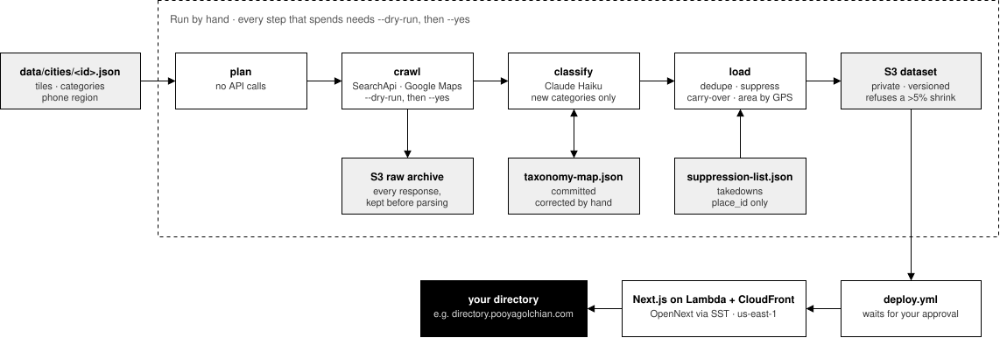

# Business Directory Toolkit

**An open-source toolkit for building a local business directory for any city,
on [SearchApi](https://www.searchapi.io/)'s Google Maps engine.**

<a href="https://www.searchapi.io/">
<picture>
<source media="(prefers-color-scheme: dark)" srcset="./logo/search-api-dark.svg">

</picture>
</a>

[](https://github.com/pooyagolchian/business-directory-toolkit/actions/workflows/ci.yml)
[](./LICENSE)
[](./.nvmrc)
[](./fixtures/searchapi)

> **Where this is.** v0.1 (pipeline) is done and measured. v0.2 (search) is
> written but not served, and no latency, Core Web Vitals or ranking numbers are
> published, because none have been taken.
> [Details](docs/decisions.md#decisions).

<p align="center"></p>

The diagram is a draw.io file with the source embedded: open
[`docs/diagrams/architecture.drawio.svg`](docs/diagrams/architecture.drawio.svg)
in draw.io to edit it, and save it back as the same file.

## What it does

- **A city is data, not code.** Tiles, categories, bounding boxes, country code
  and phone region live in [`data/cities/<id>.json`](data/cities). Nothing in
  the pipeline hard-codes a city.
- **Crawls past the result ceiling.** One query returns about 200 results at
  most, so the plan is tiles x categories.
- **Builds a clean dataset.** One record per `place_id`, area assigned by
  coordinates, categories classified by Claude Haiku 4.5 at the category level
  rather than per business.
- **Enforces takedowns on load.** A committed suppression list keeps a removed
  listing removed, even when the dataset is rebuilt from the raw archive.
- **Re-crawls without shrinking.** Re-run the crawl by hand whenever you want
  fresher data. A business the new crawl misses is carried over for 8 weeks
  after it was last seen, and a dataset that shrank by more than 5% is refused
  before it is published
  ([ADR 0016](docs/adr/0016-carry-over-businesses-between-crawls.md)).
- **Serves a site.** Next.js 16 on Lambda and CloudFront, with programmatic SEO
  pages. Typeahead is a route handler on the same function.
- **You bring your own SearchApi key.** The repository ships the machine, never
  the dataset ([ADR 0002](docs/adr/0002-do-not-redistribute-the-dataset.md)).

[directory.pooyagolchian.com](https://directory.pooyagolchian.com) is the
reference deployment, not the product
([ADR 0005](docs/adr/0005-toolkit-not-directory.md)). It is written up at
[pooyagolchian.com](https://pooyagolchian.com).

## Quickstart

Needs Node 24 (pinned in [`.nvmrc`](.nvmrc)) and pnpm 10. The first block needs
no SearchApi key and no AWS account.

```bash
nvm use                  # Node 24, from .nvmrc
corepack enable          # pnpm 10, from package.json's packageManager field
pnpm install
pnpm test                # the whole suite, offline against fixtures/, 0 credits
pnpm plan --list         # every city config in the repo
pnpm plan --city dubai   # request count and cost model, no network
```

To crawl, add your key and check the bill first. Every command that spends
credits requires `--yes`.

```bash
cp .env.example .env                    # then set SEARCH_API_KEY
pnpm crawl --city dubai --dry-run       # free: request count and credit cost
pnpm crawl --city dubai --yes           # spends credits
```

For a first run, cap the spend with `--budget 200 --only downtown`. One request
is one credit. This repository counts requests and credits, never currency,
because what a credit costs depends on your SearchApi plan. Take the request
count from `--dry-run` to [SearchApi's pricing](https://www.searchapi.io/pricing).

## Commands

| Command                                                        | What it does                                                    |
| -------------------------------------------------------------- | --------------------------------------------------------------- |
| `pnpm test`                                                    | Offline, fixtures only, costs nothing                           |
| `pnpm typecheck`                                               | TypeScript across all packages                                  |
| `pnpm plan --list`                                             | Every city config in the repo                                   |
| `pnpm plan --city dubai`                                       | Build the crawl plan, no API calls                              |
| `pnpm crawl --city dubai --dry-run`                            | Request count and credit cost before spending                   |
| `pnpm crawl --city dubai --yes`                                | Spends credits                                                  |
| `pnpm load --files-only --carry-over data/out/businesses.json` | Merge the crawl with the published set; writes `data/out/` only |
| `pnpm dataset:push`                                            | Publish to the private S3 bucket; refuses a >5% shrink          |
| `pnpm leads --list-signals`                                    | Prospect signals, no API calls                                  |
| `pnpm visibility --dry-run`                                    | AI-citation probe: request count and credit cost                |
| `pnpm visibility --yes`                                        | Spends credits (60 by default), writes `data/visibility.json`   |
| `npx sst deploy --stage dev`                                   | Deploy the stack                                                |

`pnpm demand` follows the same `--dry-run`, then `--yes` rule.

## Add your own city

Copy [`data/cities/_template.json`](data/cities/_template.json) to
`data/cities/<id>.json`. Only `tiles` (real neighbourhood centres) and
`categories` need thought; the rest is lookup. A new city needs no code change
in the pipeline.

```bash
pnpm plan --city <id>                # free
pnpm crawl --city <id> --dry-run     # free
```

Details, and what still says Dubai when you port the site:
[docs/add-a-city.md](docs/add-a-city.md).

## What a crawl costs

| Measure                  | Value                                                              |
| ------------------------ | ------------------------------------------------------------------ |
| v0.1 Dubai crawl         | 1,400 requests, 15,246 unique businesses, 14,981 in Dubai          |
| Results per query        | About 200 at most (`page=11` returns zero), so tiling is mandatory |
| Unique yield per request | 10.9 over the full crawl                                           |
| `pnpm plan --city dubai` | 1,250 requests up front, 3,170 worst case                          |

Why tiling exists, and how to predict your own city before you spend:
[docs/crawl-cost.md](docs/crawl-cost.md).

## Data, privacy and takedown

This repository does not redistribute any crawled dataset. You crawl your own
city with your own key, and `data/raw/` and `data/out/` are git-ignored, with CI
failing the build if either appears. Only business listings are collected, never
residential numbers or personal data. Removal requests are honoured
([TAKEDOWN.md](TAKEDOWN.md)): suppression runs on the load path, so a removed
`place_id` stays removed when the dataset is rebuilt. The reasoning is in
[ADR 0002](docs/adr/0002-do-not-redistribute-the-dataset.md) and
[ADR 0007](docs/adr/0007-enforce-the-takedown-promise.md); the full text is
[docs/data-and-privacy.md](docs/data-and-privacy.md).

## Documentation

| Page                                                | Covers                                                            |
| --------------------------------------------------- | ----------------------------------------------------------------- |
| [Overview](docs/overview.md)                        | Why this exists, and where to start reading                       |
| [Pipeline and repo map](docs/pipeline.md)           | Stages, what a raw result survives, what each core module decides |
| [Crawl cost](docs/crawl-cost.md)                    | Tiling, the cost model, predicting your own city                  |
| [What the crawl measured](docs/findings.md)         | Measured numbers and five ideas worth stealing                    |
| [Adding a city](docs/add-a-city.md)                 | The city config and porting the site                              |
| [Leads from your own crawl](docs/leads.md)          | `pnpm leads`, scoring, flags, consent notice                      |
| [Deployment](docs/deployment.md)                    | SST stack, dataset to CI, one-time AWS setup, SEO surface         |
| [Development and contributing](docs/development.md) | Setup details, CI gates, troubleshooting                          |
| [Data and privacy](docs/data-and-privacy.md)        | Review handling and takedown enforcement                          |
| [Decisions](docs/decisions.md)                      | Project status and the ADR index                                  |
| [Architecture decision records](docs/adr/README.md) | Every decision, including the ones that were wrong                |

## Contributing

The easiest useful contribution is fixing a wrong category in
[`data/taxonomy-map.json`](data/taxonomy-map.json); no API key needed. See
[CONTRIBUTING.md](CONTRIBUTING.md), [CODE_OF_CONDUCT.md](CODE_OF_CONDUCT.md)
and [SECURITY.md](SECURITY.md).

## Licence

[MIT](LICENSE) for the code. The data scope is set by ADR 0002 and
[TAKEDOWN.md](TAKEDOWN.md), and the SearchApi wordmark in `logo/` is not
covered by the MIT grant ([`logo/README.md`](logo/README.md)).

---

Built as part of the **SearchApi Developer Ambassador Program** by
[Pooya Golchian](https://pooyagolchian.com) ·
[GitHub](https://github.com/pooyagolchian) ·
[LinkedIn](https://linkedin.com/in/pooyagolchian)
