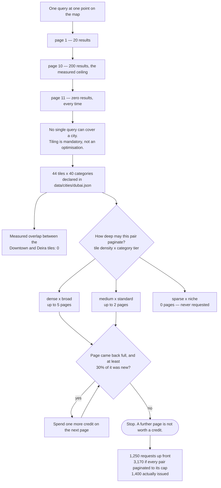

# Crawl cost

Why one query cannot cover a city, what a crawl costs in requests, and how to predict that number for your own city before you spend.

## Why tiling exists, and what a crawl costs

A single query cannot enumerate a city, so the plan is tiles × categories — and
pagination depth, set by tile density and category tier, is the one dial that
moves the credit bill.



The whole cost model is one lookup table in
[`plan.ts`](../packages/pipeline/src/plan.ts):

|            | broad | standard | niche |
| ---------- | ----: | -------: | ----: |
| **dense**  |     5 |        3 |     1 |
| **medium** |     3 |        2 |     0 |
| **sparse** |     1 |        0 |     0 |

`depth = PAGE_CAP[tile.density][category.tier]`, and a **0 drops the pair from
the plan entirely** — crawling law firms in the desert spends money to find
nothing. Nothing in that table may exceed 10, because `page=11` was measured to
return zero results; the probe is committed as
[`google_maps_downtown_page11_empty.json`](../fixtures/searchapi/google_maps_downtown_page11_empty.json),
and it carries no `local_results` key at all.

### Predict your own city before you spend

```text
requests_floor   = pairs where depth >= 1                    (only page 1 is planned)
requests_ceiling = sum of depth over those same pairs        (if every pair maxed out)
credits          = requests × 1
businesses       ≈ requests × 10.9                           (not 17.5 — see below)
```

Dubai, worked through from [`dubai.json`](../data/cities/dubai.json) — 44 tiles
(15 dense, 18 medium, 11 sparse) and 40 categories (10 broad, 20 standard,
10 niche):

```text
floor    dense  15 × (10 + 20 + 10) =  600
         medium 18 × (10 + 20)      =  540   niche is 0 at medium
         sparse 11 ×  10            =  110   only broad survives
                                     -------
                                       1,250 requests up front

ceiling  dense  15 × (10×5 + 20×3 + 10×1) = 1,800
         medium 18 × (10×3 + 20×2)        = 1,260
         sparse 11 × (10×1)               =   110
                                            -------
                                              3,170 worst case
```

The real run landed at **1,400 requests** — inside the band, which is the
adaptive pagination working. The two levers are both in the city JSON:

- One extra **broad** category costs Dubai 140 worst-case requests
  (15×5 + 18×3 + 11×1).
- One extra **niche** category costs 15 — dense tiles only.
- Promoting one tile from `medium` to `dense` costs 50.

Always run `--dry-run` and state the number before widening a crawl. That is
[rule 4](../CLAUDE.md) in this repo, not a suggestion.
