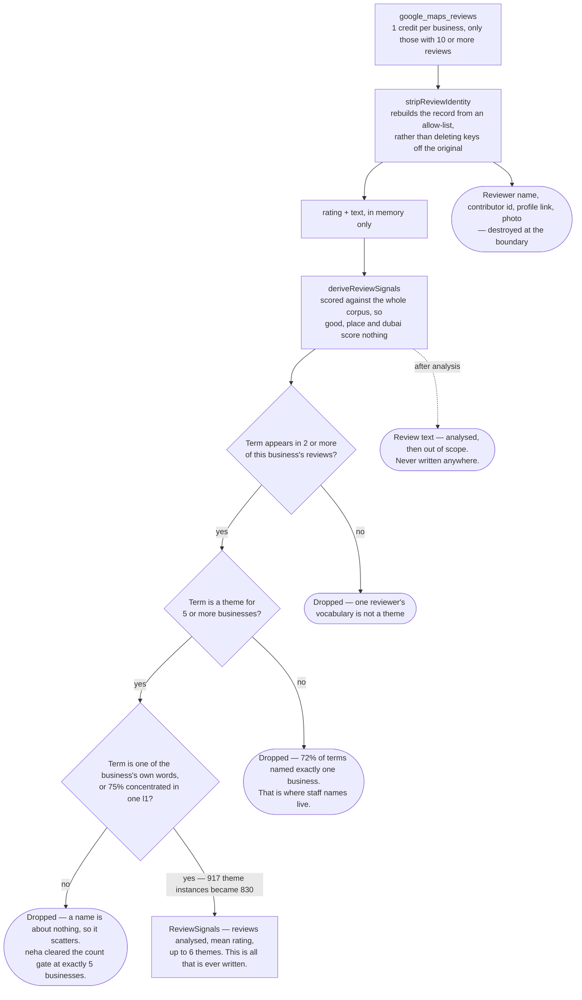

# Data and privacy

What this repository does and does not ship, how review data is handled, and how removal requests are enforced.

## Data, privacy and takedown

**This repository does not redistribute any crawled dataset.** Listings come from
Google Maps via SearchApi and are subject to their terms. What ships is the
machine: the pipeline, the crawl plans, the taxonomy map, the suppression list,
and a handful of test fixtures. You crawl your own city with your own key, and
`pnpm export` hands you your own data as CSV, JSON or NDJSON. This is enforced
rather than intended — the guard step is in
[Development](./development.md#development).

**Business listings only. No residential numbers, no personal data.** Reviews are
used as a _source_, never as content.

**Removal requests are honoured: see [TAKEDOWN.md](../TAKEDOWN.md).** Suppression
runs on the **load** path, not the fetch path, so a removed `place_id` stays
removed even when the dataset is rebuilt from the raw archive — filtering at
fetch time would leave the archive as a way back in.
[`data/suppression-list.json`](../data/suppression-list.json) is committed rather
than local, because a suppression list that only exists on one laptop protects
nobody, and it holds opaque `place_id` values only — never a name, a phone number
or an address. ([ADR 0007](./adr/0007-enforce-the-takedown-promise.md))

Security policy and private disclosure: **[SECURITY.md](../SECURITY.md)**.
