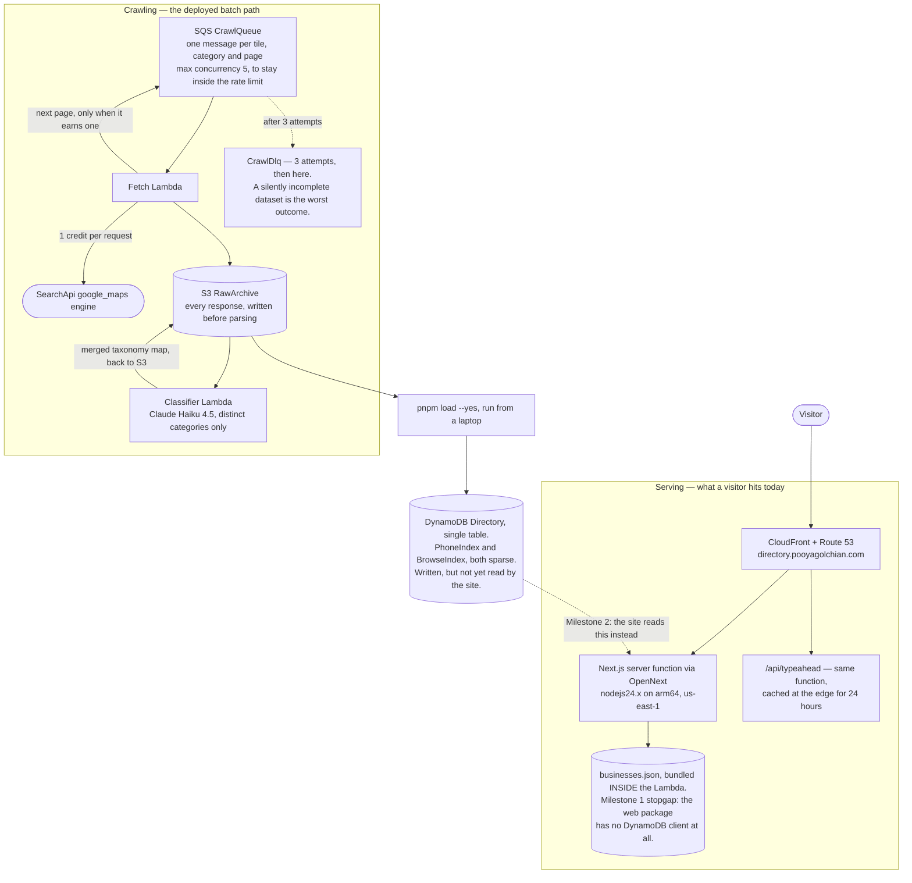

# Deployment

What the SST stack deploys, how the dataset reaches CI and the Lambda, and the one-time setup per AWS account.

## Architecture and deployment



**Milestone 1 serves the site from a JSON snapshot bundled into the Lambda at
build time.** [`scripts/bundle-data.mjs`](../packages/web/scripts/bundle-data.mjs)
copies the crawl output into `packages/web/.data` at `predev` and `prebuild`, and
`outputFileTracingIncludes` in
[`next.config.ts`](../packages/web/next.config.ts) traces it into the server
function. Every lookup is a linear scan of 14,981 records, held in memory per
container.

The DynamoDB single-table design **is** provisioned and loaded — `pnpm load
--yes` writes the canonical `BIZ#` items, the sparse `PhoneIndex` and
`BrowseIndex`, and one `PFX#` typeahead item per 2–4 character title prefix — but
**nothing reads it yet.** Milestone 2 swaps the backend behind index-shaped
signatures in [`lib/data.ts`](../packages/web/lib/data.ts) that already name the
index waiting for each one, so it is a client swap rather than a page rewrite.
That stopgap, its cost, and the two other places in this repo that still claim
otherwise are all written down in
[ADR 0009](./adr/0009-bundle-the-dataset-into-the-lambda.md).

**There is deliberately no separate API service.** Inserting API Gateway would
add a second cold start straight into the latency numbers Milestone 2 exists to
publish, and `us-east-1` already spends ~250 ms of distance on a Dubai audience
([ADR 0003](./adr/0003-deploy-region.md)).

```bash
npx sst secret set SearchApiKey    <value> --stage dev   # only for cloud crawls
npx sst secret set AnthropicApiKey <value> --stage dev   # only for cloud classify
npx sst deploy --stage dev
```

`production` is protected and retains its data on removal; every other stage is
`removal: "remove"`. The GitHub deploy workflow is `workflow_dispatch`-only,
runs typecheck + lint + test first, and assumes its AWS role via OIDC, so no
long-lived key exists anywhere.

**Main-only is enforced by the GitHub environment, not by the trust policy.**
An earlier version of this file said the opposite — that IAM scoped `sub` to
`refs/heads/main` and `deploy.yml` needed no ref guard. That is wrong, and
wrong in a way that would have failed the first real deploy: the job declares
`environment: ${{ inputs.stage }}`, and GitHub swaps the OIDC subject to
`repo:OWNER/REPO:environment:NAME` whenever a job uses an environment. A trust
policy matching only the `ref:` form would never match at all.

So the control lives in two places, and both are load-bearing:

- **IAM** scopes the role to this repository — `environment:production`,
  `environment:dev`, and `ref:refs/heads/main`. No other repository can assume
  it, which is the property that matters most.
- **The `production` and `dev` environments** each carry a deployment-branch
  policy allowing only `main`, plus a required reviewer on `production`. That
  is what makes it main-only, and what puts a human in front of a live deploy.

#### Getting the dataset to CI

`data/out/` is git-ignored ([ADR 0002](./adr/0002-do-not-redistribute-the-dataset.md))
and required at build time ([ADR 0009](./adr/0009-bundle-the-dataset-into-the-lambda.md)),
so a fresh checkout has the requirement and not the file. It travels through a
private, versioned S3 bucket instead —
[ADR 0015](./adr/0015-ship-the-dataset-to-ci-through-private-s3.md):

```bash
pnpm dataset:push   # after pnpm load, from a machine that has the data
pnpm dataset:pull   # what deploy.yml runs, with its OIDC session
```

Both read `DATASET_S3_URI`. Nothing links `pnpm load` to `pnpm dataset:push`, so
**CI will happily deploy a stale dataset forever and every run will look green**
— that cost is in ADR 0015's Bad list rather than hidden here.

#### One-time setup per AWS account

Deploying through the workflow needs two repository variables. The
configuration check at the top of the job fails naming whichever is missing,
before anything billable runs.

```bash
gh variable set DATASET_S3_URI      --body "s3://<bucket>/<city>"
gh variable set AWS_DEPLOY_ROLE_ARN --body "arn:aws:iam::<account>:role/<role>"
```

The role must trust **only this repository**, or any repository on GitHub can
assume it:

```jsonc
"StringLike": {
  "token.actions.githubusercontent.com:sub":
    "repo:pooyagolchian/business-directory-toolkit:ref:refs/heads/main"
}
```

Both variables are set for this repository, and
`github-actions-directory-from-scratch` is the role they point at. If you are
forking, the sentence above is the whole setup — until that role exists, deploys
fall back to somebody's shell, which is exactly what the workflow exists to
avoid.

### SEO surface

| Route                                   | What it is                                                                                                                                                      |
| --------------------------------------- | --------------------------------------------------------------------------------------------------------------------------------------------------------------- |
| `/area/[area]/[l2]`                     | The money pages — "Italian restaurants in Marina" is the query shape people type. Demand-first prerendering, capped at 1,000.                                   |
| `/category/[l2]`                        | Every category prerendered. `PAGE_SIZE = 120` rows to the client filter — shipping 1,164 restaurants as JSON is a payload, not a feature.                       |
| `/business/[slug]`                      | `LocalBusiness` JSON-LD. `aggregateRating` is **deliberately omitted**: the rating is Google's, not first-party, and claiming it risks a manual action.         |
| `/search`                               | Excluded three ways — `robots: { index: false }`, disallowed in `robots.ts`, and absent from `sitemap.ts`. Query-string permutations are the crawl-budget sink. |
| `/areas`, `/categories`, `/area/[area]` | The browse hubs — internal linking, so no money page is an orphan. Prerendered, and in the sitemap at 0.8 and 0.7.                                              |
| `/sitemap.xml`                          | Home at 1.0, the `/categories` and `/areas` hubs at 0.8, money pages at 0.9, categories and areas at 0.7, businesses at 0.6.                                    |

`MIN_FOR_INDEX = 3` is declared **twice** — once in the area × category page at
[`packages/web/app/area`](../packages/web/app/area) and once in
[`sitemap.ts`](../packages/web/app/sitemap.ts) — and the two must be changed
together, or the sitemap submits URLs that carry a `noindex`.
