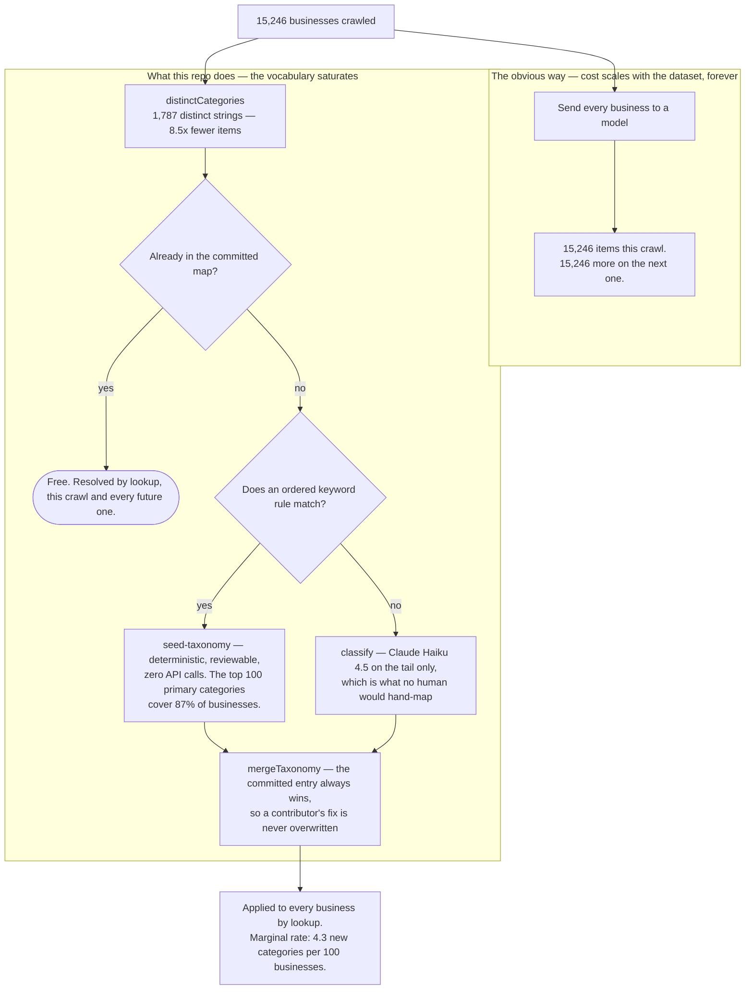

# What the crawl measured

The numbers from the v0.1 Dubai crawl, and five design ideas that came out of getting them.

## What the crawl actually measured

Every number here came from running it. Several contradict what the
documentation would lead you to expect, and the ones that contradict an earlier
prediction of ours are labelled as such rather than quietly dropped.

| Finding                      | Measured                                                                                                                                                                                                                                                        |
| ---------------------------- | --------------------------------------------------------------------------------------------------------------------------------------------------------------------------------------------------------------------------------------------------------------- |
| **Hard ceiling per query**   | **~200 results.** `page=11` returns a response with no `local_results` key at all. Tiling is mandatory, not an optimisation. ([fixture](../fixtures/searchapi/google_maps_downtown_page11_empty.json))                                                          |
| **Tiles are disjoint**       | **0 overlap** measured between the Downtown and Deira tiles. The strategy costs nothing in duplication.                                                                                                                                                         |
| **Unique yield per request** | **10.9** over the full v0.1 crawl. The in-query figure of ~17.5 **overestimates by 38%**, because cross-category overlap (**~45%** on the same run) dominates once you crawl more than one category. `pnpm plan` still prints 17.5 — read it as an upper bound. |
| **`types[]` ordering**       | **Alphabetical, not ranked.** 85% of tails sorted, so array position carries no relevance signal and cannot break a tie.                                                                                                                                        |
| **Category saturation**      | 15,246 businesses → **1,787 distinct category strings**. Marginal discovery fell from **47.7 to 4.3** new categories per 100 businesses across the full crawl. ([ADR 0006](./adr/0006-category-saturation.md))                                                  |
| **Provenance ≠ location**    | **52% of businesses** (v0.1 crawl, 1,400 requests) sat in a different tile than the query that found them. Google returns results from a _radius_. ([ADR 0011](./adr/0011-area-from-coordinates-not-provenance.md))                                             |
| **Phone coverage**           | **92.2%**, and that is a ceiling — a 15-business probe of the detail endpoint recovered exactly 1 phone, and it was a `+91` number, correctly rejected.                                                                                                         |
| **A 5.0 means no evidence**  | Median reviews climb **12, 18, 48, 93, 139** with rating — then collapse to **11** at exactly 5.0, where 47% of businesses have under ten reviews. 2,283 Dubai businesses hold an exact 5.0. ([ADR 0010](./adr/0010-credibility-weighted-ranking.md))           |

**v0.1 crawl: 1,400 requests → 15,246 unique businesses → 14,981 inside Dubai,
zero errors.** Taxonomy coverage 99.5% **of businesses**.

Re-running `distinctCategories()` today prints **1,787** where
[ADR 0006](./adr/0006-category-saturation.md) and `CLAUDE.md` record 1,788
from the same corpus; this table quotes what the shipped code prints, and the
8.5× multiple is unaffected.

The 52% and ~45% figures are run results from the v0.1 Dubai crawl, printed
by `pnpm load` and `pnpm crawl` respectively. Because `data/out/` is git-ignored
by design, they are not reproducible from anything committed here — unlike 92.2%
(which falls straight out of the load gate) and 10.9 (= 15,246 ÷ 1,400, both
stated above). The same applies to every figure below that traces only to a
source comment from that run: **723** distinct primary categories, **87.3%** and
**93.3%** Zipf coverage, and the **90%** / **10,461** amenity counts in the
[`packages/core` table](./pipeline.md#what-each-packagescore-module-decides).

## Five ideas worth stealing

### 1. Classify categories, not businesses

The obvious way to clean Google's category strings is to send every business to
an LLM. That scales linearly with your dataset, forever.

Category vocabulary **saturates** while business count does not: 15,246
businesses contain only 1,787 distinct category strings — **8.5× fewer items**,
with a final marginal rate of 4.3 new categories per 100 businesses.

Better still, the head does not need a model at all. The **723 distinct
_primary_ categories** are Zipf-distributed: the top 100 cover **87.3%** of
businesses and the top 200 cover 93.3%. So `pnpm seed-taxonomy` classifies the
head with ordered keyword rules — deterministic, free, reviewable — and the
model's real job is the tail no human would hand-map.

The committed [`taxonomy-map.json`](../data/taxonomy-map.json) reaches **99.5% of
businesses** — 1,250 of the 1,787 distinct strings, which is 70% of the
vocabulary but almost all of the corpus, because the unmapped tail is the rare
end of a Zipf curve. **95.8 of those 99.5 points were reached by the keyword
rules alone**, measured on the v0.1 corpus before the map was committed. Running
`pnpm seed-taxonomy` today reports 99.5%, not 95.8% — it measures the committed
map (rules + hand tail + LLM tail), and there is no rules-only flag to isolate
them. It also needs `data/out/raw-records.json`, so it cannot run on a fresh
clone.

### 2. Let demand decide which pages to build

The crawl measures **supply** — how many nurseries exist. It says nothing about
**demand** — how many people look for one.

`pnpm demand` asks Google's autocomplete, which is ordered by real query
popularity. The two disagree sharply:

| Category    | Businesses | Neighbourhoods people search |
| ----------- | ---------: | ---------------------------: |
| Restaurants |      1,164 |                            4 |
| Nurseries   |        213 |                        **7** |
| Nail Salons |         18 |                            4 |

Demand column is reproducible from [`data/demand.json`](../data/demand.json),
which **is** committed — 80 categories, 1,076 suggestions, 154 of them naming a
neighbourhood across 46 categories. Supply column is counted over the v0.1 Dubai
crawl output
(14,981 businesses); `data/out/` is git-ignored by design, so that column is a
run result rather than something a reader can re-derive from this repo.

Generating every possible page and hoping is the default approach to
programmatic SEO. Selecting pages from measured demand is cheaper and far more
likely to rank — and it tells you what to **crawl** next, too. `demandedPages()`
seeds `generateStaticParams` in autocomplete-popularity order _before_ supply
fills the remainder, because ranking by supply would have put 1,164 restaurants
ahead of a nursery query people type far more often.

### 3. Archive raw responses before parsing

Every response is written to storage untouched before anything reads it. That
one habit means normalisation, taxonomy and loading can all be re-run for **zero
credits** — `pnpm load --from-archive --dry-run` rebuilds the whole dataset from
disk and prints `Rebuilt N records from data/raw/ — no credits spent.` It is
also how the app was developed against a crawl that was still running.

**The archive is also the biggest footgun in the repo.** A single unresolvable
path in the data loader made Next's file tracer give up and wildcard the
directory: `page.js.nft.json` listed **1,679 files, 1,400 of them raw crawl
archive**, carrying **20,226 verbatim Google review snippets**, some naming
individual employees. None of it was read by any code; all of it would have
shipped inside the Lambda.
[`lib/data.ts`](../packages/web/lib/data.ts) now has exactly one static data path
and no fallback, and the comment there explains that this is a privacy control
rather than a style preference.

### 4. A perfect score is the bottom of the evidence, not the top of the scale

Sorting a directory by raw star average lets one 5-star review beat 2,000
averaging 4.6. So listings rank on a **credibility-weighted mean**
([`rank.ts`](../packages/core/src/rank.ts)) — the corpus average as a prior, moved
by each business's own reviews in proportion to how many there are.

The parameter worth stealing is that the weight is **derived from the corpus,
not hardcoded**: it is the corpus median review count, so the same code behaves
sensibly in a city with a tenth of Dubai's review volume. An unrated business
scores exactly the prior, which is the honest reading of no information.

### 5. A privacy fix that is a property, not a blocklist

Stripping reviewer identity turned out not to be enough. Reviewers thank
individual staff by name, and TF-IDF rewards exactly that shape — a term
frequent for one business and rare everywhere else. The first live run produced
`Sofitel → manava, wilbert, umesh`: three employees about to appear on a public
page.

A name blocklist would have been endless and culture-specific. The fix is a
property instead — **a real theme recurs across many businesses; a person's name
belongs to one.** 72% of theme terms appeared for exactly one business, against
`shisha` at 18 and `seafood` at 10. A second gate catches what the first misses,
because they fail differently: recurrence alone let a common personal name
through at exactly 5 businesses, and topicality — being a ratio — does not weaken
as the crawl grows.

The cost is stated rather than hidden: **917 theme instances become 830**, and
eight terms disappear entirely.
([ADR 0008](./adr/0008-themes-must-generalise-and-be-topical.md))
