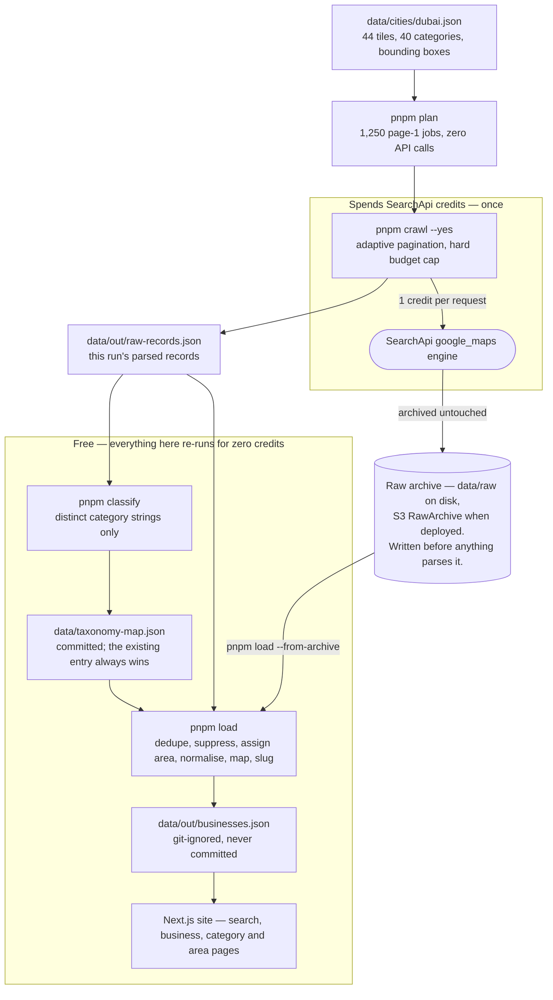
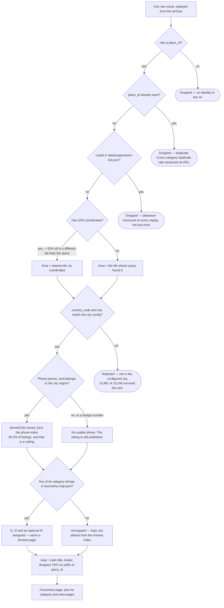

# Pipeline and repo map

How a raw SearchApi response becomes a dataset, where each piece of the repository lives, and the decision each `packages/core` module encodes.

## The pipeline

Exactly one edge in the whole pipeline spends credits. Everything downstream of
the raw archive re-runs for free, which is what `pnpm load --from-archive` is
for.



| Command                                                               | Does                                                                 | Costs                                                                                                 |
| --------------------------------------------------------------------- | -------------------------------------------------------------------- | ----------------------------------------------------------------------------------------------------- |
| [`pnpm plan`](../packages/pipeline/src/cli/plan.ts)                   | Build the crawl plan and print its bill                              | nothing — makes no API calls at all                                                                   |
| [`pnpm crawl`](../packages/pipeline/src/cli/crawl.ts)                 | Fetch, archive raw, dedupe as it goes                                | **1 credit per request.** Dubai: 1,250 floor, 3,170 ceiling, `--budget` default 2,000                 |
| [`pnpm seed-taxonomy`](../packages/pipeline/src/cli/seed-taxonomy.ts) | Classify the category head with 132 ordered keyword rules            | nothing — no model call of any kind                                                                   |
| [`pnpm classify`](../packages/pipeline/src/cli/classify.ts)           | Classify the category **tail** with an LLM                           | Anthropic tokens, not credits — Haiku 4.5 at \$1.00/Mtok in, \$5.00/Mtok out, halved on the Batch API |
| [`pnpm load`](../packages/pipeline/src/cli/load.ts)                   | Dedupe, suppress, assign area, normalise, gate, write                | 0 credits. DynamoDB write units only, and only with `--yes`                                           |
| [`pnpm demand`](../packages/pipeline/src/cli/demand.ts)               | Measure real search demand via Google autocomplete                   | 1 credit per category. The committed `demand.json` covers 80 → 80 credits                             |
| [`pnpm reviews`](../packages/pipeline/src/cli/reviews.ts)             | Derive review signals, never review text                             | 1 credit per business **sampled** — `>= 10` reviews, `--limit` default 1000                           |
| [`pnpm export`](../packages/pipeline/src/cli/export.ts)               | CSV / JSON / NDJSON of _your_ crawl, filterable by category and area | nothing                                                                                               |

Every command that spends refuses to without `--yes`, and every one has a
`--dry-run` that prints the bill and exits 0. On the v0.1 corpus,
`pnpm classify --dry-run` reports `Already mapped 1,250 / Need classification
537 / Requests to the model 11` — the committed map resolves 70% of the
vocabulary and 99.5% of _businesses_ for free, and only the 537-string tail
would cost anything. A re-crawl that introduces no new strings takes the other
branch entirely and prints
`Marginal cost of this crawl's taxonomy: $0.0000`.

### What one raw result has to survive

Every gate on the load path, in the order the code applies them. Note which
failures drop a record and which merely leave a field empty.



`pnpm load --dry-run` prints the five v0.1 acceptance gates on every run: unique
`place_id`s `>= 10,000`, E.164 phone coverage `>= 90%`, taxonomy coverage
`>= 99%` **of businesses**, slugs unique, and `zero non-AE rows loaded`. Two of
those thresholds were revised **down** on evidence, and the reasoning is
committed in the [file header](../packages/pipeline/src/cli/load.ts) rather than
lost in a commit message.

That last gate label is itself a residual Dubai-ism, alongside the web-layer
ones listed at the top: `load.ts` hardcodes `AE` in the label and prints
`Rejected non-Dubai` beside it, even though the filter it reports on reads
`countryCode` out of the city config. The gate is city-agnostic; its wording is
not yet.

## Repo map

```text
packages/
  core/      Pure domain logic. No I/O, no AWS, no city. TDD is mandatory here.
  pipeline/  Offline batch CLIs (plan → crawl → classify → load) + Lambda handlers.
  web/       Next.js 16 App Router. The site, and /api/typeahead.
data/
  cities/    One JSON file per city — the toolkit's whole extension point.
  taxonomy-map.json  taxonomy-tail.json  demand.json  suppression-list.json
  raw/  out/ Crawl output. Git-ignored, and CI fails the build if either appears.
fixtures/searchapi/  Four recorded responses. Every engine response a test needs comes from here.
docs/adr/    Architecture decision records, including the ones that were wrong.
sst.config.ts  S3 · DynamoDB · SQS + DLQ · Lambda · CloudFront, all us-east-1.
```

There is **no `packages/search`**. Typeahead is an App Router route handler at
[`packages/web/app/api/typeahead/route.ts`](../packages/web/app/api/typeahead/route.ts),
running on the same server function as the site.

### What each `packages/core` module decides

Every file here exists because of one decision. The comment at the top of each
explains _why_, which is the part the code cannot hold.

| File                                                      | The decision it encodes                                                                                                                                     |
| --------------------------------------------------------- | ----------------------------------------------------------------------------------------------------------------------------------------------------------- |
| [`nearest.ts`](../packages/core/src/nearest.ts)           | Area comes from coordinates, not from the query that found the business — and a degree of longitude is ~11% short at Dubai's 25°N, so the scale is applied. |
| [`rank.ts`](../packages/core/src/rank.ts)                 | Credibility-weighted mean, with the prior derived from the corpus rather than hardcoded, so it ports to a city with different review volumes.               |
| [`distribution.ts`](../packages/core/src/distribution.ts) | Two independent series, never two y-axes on one chart — that would invent a correlation the data does not contain.                                          |
| [`phone.ts`](../packages/core/src/phone.ts)               | `libphonenumber-js/max`, because the `min` build cannot tell a UAE landline from a mobile. Region is a required argument, never a defaulted `"AE"`.         |
| [`slug.ts`](../packages/core/src/slug.ts)                 | FNV-1a for a stable suffix — slugs live in Google's index and must not drift between deploys. Arabic is dropped, not transliterated: the schemes disagree.  |
| [`jsonld.ts`](../packages/core/src/jsonld.ts)             | `JSON.stringify` is not safe inside a `<script>` tag. The HTML parser scans for `</script` regardless of quoting, and a business owner controls their name. |
| [`taxonomy.ts`](../packages/core/src/taxonomy.ts)         | The primary `type` anchors l1/l2; `types[]` is alphabetical, so array position cannot break a tie between competing refinements.                            |
| [`reviews.ts`](../packages/core/src/reviews.ts)           | Reviews are a **source**, never content. Reviewer identity is stripped at the boundary, before anything else touches the record.                            |
| [`generalise.ts`](../packages/core/src/generalise.ts)     | A real theme recurs across many businesses; a person's name belongs to one. Two gates, because they fail differently.                                       |
| [`suppression.ts`](../packages/core/src/suppression.ts)   | Takedowns are enforced on the load path, so a replay from the archive cannot bring a removed listing back. A malformed list throws rather than returning ∅. |
| [`dedupe.ts`](../packages/core/src/dedupe.ts)             | One record per `place_id`, globally — the ~45% cross-category duplicate rate is absorbed here rather than stored twice.                                     |
| [`city.ts`](../packages/core/src/city.ts)                 | `isInCity(record, city)` replaced `isDubaiListing(record)`. The engine returns `"Dubai"` and `"Dubai - United Arab Emirates"`; the split is generic.        |
| [`amenities.ts`](../packages/core/src/amenities.ts)       | 90% of listings carry an `extensions` block the pipeline was discarding. Wheelchair access was already known for 10,461 businesses, and already paid for.   |
| [`faq.ts`](../packages/core/src/faq.ts)                   | A question is emitted only when this page's own data can answer it. The same FAQ across 800 URLs is the definition of thin content.                         |
| [`types.ts`](../packages/core/src/types.ts)               | `CityConfig` — the shape a new city must satisfy.                                                                                                           |
